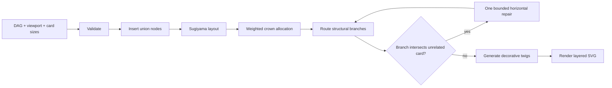

# Pedigree Tree Layout Design

- **Status:** Approved
- **Date:** 2026-10-11
- **Requirements:** [`../requirements/pedigree-tree-layout.md`](../requirements/pedigree-tree-layout.md)
- **Primary decision:** [`../decisions/0001-svg-layered-dag-layout.md`](../decisions/0001-svg-layered-dag-layout.md)

## 1. Design summary

Use a deterministic layered-DAG layout to compute person mounting points and invisible union junctions. Render the normalized relationship graph as tapered SVG Bézier branches, then add deterministic decorative twigs in remaining free space. Keep semantic layout, branch geometry, decoration, and SVG rendering independent.

The first implementation should use `d3-dag` for Sugiyama layering, crossing reduction, and initial coordinates. A bounded project-specific post-pass distributes horizontal space by reachable subgraph area, expands the virtual canvas when required, and repairs branch/card collisions. It must not implement the full non-convex density optimization described in `Communications-With-ChatGPT.md` unless measured layouts prove the simpler pipeline insufficient.

## 2. Components

| Component | Responsibility |
|---|---|
| Input validator | Validate IDs, root, references, dimensions, DAG acyclicity, and reachability |
| Graph normalizer | Insert union nodes and produce the internal layout graph |
| Layered layout | Assign ranks, reduce crossings, and calculate initial coordinates |
| Space allocator | Weight branches, distribute the tree crown, enforce spacing, and size the virtual canvas |
| Branch router | Convert normalized edges into smooth structural branch centerlines and envelopes |
| Decoration generator | Add deterministic non-semantic twigs and foliage outside exclusion zones |
| SVG renderer | Render ordered SVG layers and metadata |
| Export adapter | Serialize SVG and optionally derive PNG/PDF |

## 3. Internal data model

```ts
interface PedigreeInput {
  rootId: string;
  nodes: PersonNode[];
  edges: RelationshipEdge[];
  viewport: { width: number; height: number };
  layout: {
    margin: number;
    horizontalGap: number;
    verticalGap: number;
    seed: string;
  };
}

interface LayoutNode {
  id: string;
  kind: "person" | "union";
  width: number;
  height: number;
  rank: number;
  x: number;
  y: number;
}

interface StructuralBranch {
  edgeId: string;
  sourceId: string;
  targetId: string;
  centerline: CubicBezier[];
  startWidth: number;
  endWidth: number;
  bounds: Rect;
}
```

Union IDs must be derived deterministically from sorted parent IDs, relationship identity, and child ID. Generated IDs must never collide with user IDs.

## 4. Data flow



Only one branch-aware repair pass is allowed initially. If an intersection remains, return a routing diagnostic rather than entering an unbounded optimization loop.

## 5. Layout algorithm

### 5.1 Normalize relationships

1. Validate the original DAG.
2. For each multi-parent relationship, insert one invisible union node.
3. Replace parent-to-child edges with parent-to-union and union-to-child edges.
4. Retain a mapping from normalized edges to original relationship IDs.

### 5.2 Assign ranks and order

Run a Sugiyama layout with real node dimensions and configured gaps. Use simplex layering, two-layer crossing reduction, and deterministic coordinate assignment. Convert the library's orientation to bottom-to-top screen coordinates after layout.

The designated root must occupy the lowest rank. Every normalized edge must advance at least one rank; long edges may receive internal routing points from the layout engine.

### 5.3 Allocate tree-crown width

For each node, compute a branch weight from the union of reachable visible descendants rather than recursively double-counting shared DAG descendants:

```text
weight(node) = sum(card area for unique reachable person nodes) + spacing allowance
```

Within each rank, use the initial crossing-minimized order. Allocate horizontal intervals in proportion to branch weight, then compact them while respecting card boxes and minimum gaps. Keep the root's center aligned with the virtual canvas center.

### 5.4 Fit or expand

Compute the minimum bounding box including cards, labels, and margins. If it exceeds the initial viewport, increase the virtual width or height; never scale cards below their requested dimensions. If it fits, distribute spare space up to configured utilization targets without violating minimum gaps.

## 6. Branch geometry

Each normalized edge is represented by one or more cubic Bézier centerlines. Control points follow the upward growth direction and are biased toward the source tangent so lower branches resemble a trunk splitting upward.

Branch width is a function of the unique visible descendants carried by the branch. Width decreases monotonically toward the tree crown and is clamped to style-configured minimum and maximum values. Parent-to-union paths visually merge at the union coordinate; union-to-child paths continue from the same junction.

The router creates exclusion rectangles around unrelated cards and labels. It first adjusts Bézier control points. If that fails, it reports the collision to the single bounded horizontal repair pass. Branches may cross only when topology and available space make avoidance impossible; crossings must be reported in layout diagnostics.

## 7. Decorative geometry

Decoration generation runs after structural routing. Candidate attachment sites are sampled along branches where curvature, available clearance, and branch thickness permit a twig. A seeded pseudo-random generator chooses side, angle, length, and optional foliage variants.

Every candidate is rejected if its envelope intersects:

- a person-card or label exclusion box;
- a union-junction clearance radius;
- a hanging connector;
- another accepted decorative element beyond the configured density.

Decorations receive stable IDs derived from branch ID, sample index, and seed.

## 8. SVG layers

```xml
<svg>
  <g data-layer="background" />
  <g data-layer="structural-branches" />
  <g data-layer="decorative-growth" />
  <g data-layer="hanging-connectors" />
  <g data-layer="person-cards" />
</svg>
```

Use one SVG coordinate system for all layers. Layer separation is logical and DOM-based; no duplicated coordinate transforms are allowed. The root SVG uses a `viewBox` equal to the virtual canvas and may be displayed inside a smaller interactive viewport.

## 9. Determinism and errors

Sort IDs before any tie-breaking operation. Seed every decorative choice. Do not depend on object insertion order, current time, or platform randomness.

Return structured errors for invalid graphs and structured diagnostics for layout degradation:

- invalid or cyclic DAG;
- missing/unreachable root;
- invalid dimensions;
- unresolved branch/card collision;
- unavoidable structural branch crossing;
- export failure.

A degraded but valid layout may render only when diagnostics are returned with it; invalid input must not render a misleading partial tree.

## 10. Verification strategy

Permanent tests should cover observable invariants:

- root bottom-center placement;
- monotonic upward edges;
- no card overlap;
- deterministic union normalization;
- deterministic layout and decoration;
- weighted width allocation for unequal subgraphs;
- virtual-canvas expansion;
- exclusion-zone enforcement;
- semantic-edge-to-branch traceability;
- SVG layer order and complete bounds.

Use small fixed DAG fixtures: single node, chain, balanced split, asymmetric split, two-parent union, shared descendants, and an intentionally cramped viewport. Visual regression snapshots may supplement but not replace geometry assertions.

## 11. Deferred work

- interactive editing;
- incremental/stable layout;
- more than 100 visible nodes;
- unconstrained density-field optimization;
- automatic semantic extraction from artwork;
- photorealistic branches or physically simulated growth.
